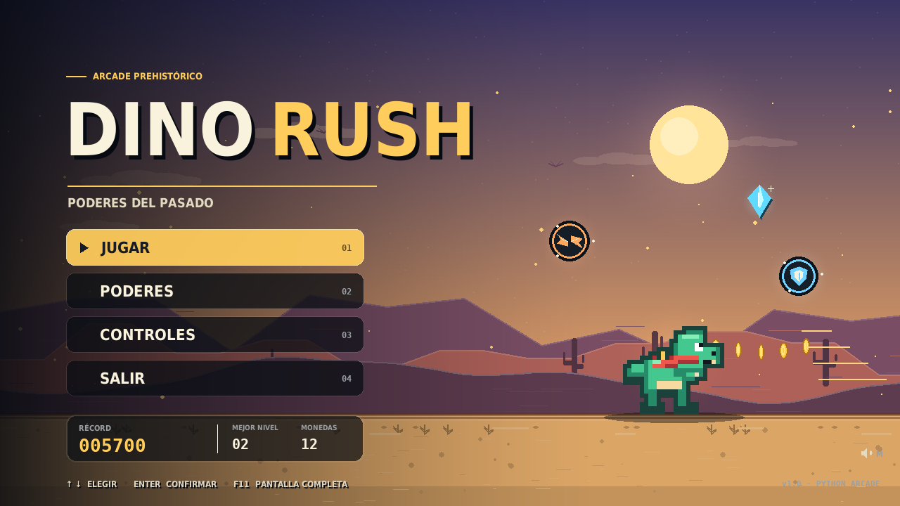
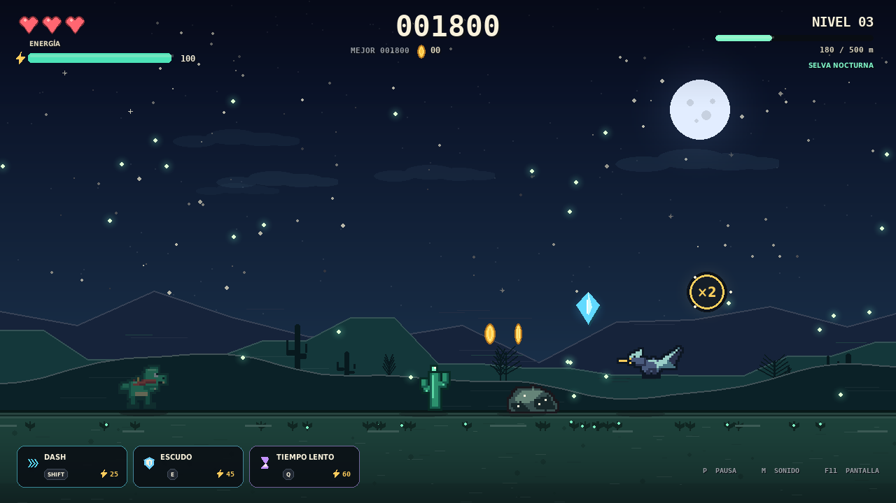
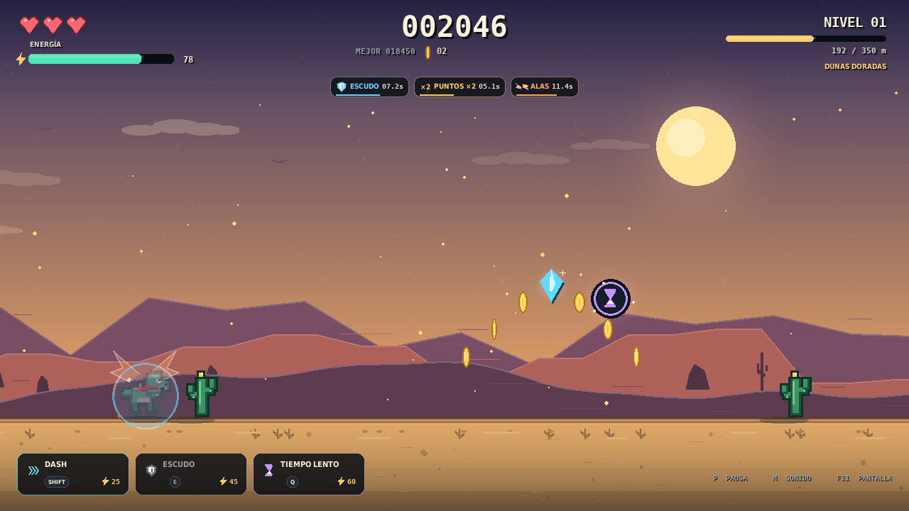
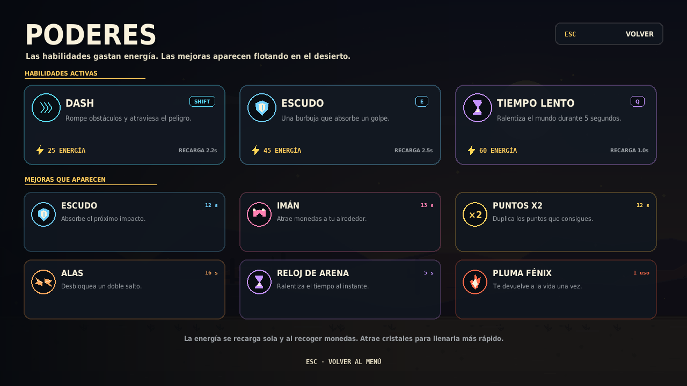

# DINO RUSH · Poderes del Pasado

Un runner arcade en Python inspirado en el dinosaurio del navegador, con
biomas, niveles, habilidades, mejoras, récords y arte/audio generados por
código (sin archivos externos).



## Características

- **Runner infinito por niveles**: cada nivel aumenta la velocidad y la
  distancia objetivo. Al superarlo recuperas un corazón y energía.
- **Cuatro biomas rotativos**: Dunas Doradas, Cañón Carmesí, Selva Nocturna
  y Volcán Rugiente. Cada uno tiene su paleta, clima, parallax y decoración.
- **Tres habilidades activas** que consumen energía.
- **Seis mejoras recogibles** (escudo, imán, puntos ×2, alas, reloj de arena
  y pluma fénix).
- **Tres corazones** (el fénix puede salvarte una vez), invencibilidad
  temporal tras un golpe y energía que se recarga con el tiempo.
- **Récords persistentes**: puntuación, distancia, nivel, monedas totales y
  partidas jugadas.
- **Arte y música procedurales**: el juego no necesita descargar recursos.
- **Teclado y ratón**: menús clicables y tarjetas de habilidad del HUD
  clicables.
- **Resolución lógica 1280×720** con escalado y letterboxing al redimensionar.
- **Pantalla completa** con `F11` y silenciado con `M`.

## Requisitos

- Python **3.10 o superior** (probado con Python 3.14).
- `pygame-ce` 2.5.3 o superior.

## Instalación y ejecución

Desde la carpeta del proyecto:

```bash
python3 -m pip install -r requirements.txt
python3 main.py
```

También puedes usar el lanzador:

```bash
./run.sh
```

Si tu distribución bloquea la instalación global de paquetes, usa un entorno
virtual:

```bash
python3 -m venv .venv
source .venv/bin/activate
pip install -r requirements.txt
python3 main.py
```

En sistemas donde `venv` no esté disponible, una alternativa es:

```bash
python3 -m pip install --user --break-system-packages -r requirements.txt
```

## Controles

| Acción | Tecla |
| --- | --- |
| Saltar | `Espacio`, `↑` o `W` |
| Saltar más alto | Mantén pulsado el salto |
| Agacharse | `↓` o `S` |
| Caída rápida (en el aire) | `↓` o `S` |
| Dash | `Shift` |
| Escudo | `E` |
| Tiempo lento | `Q` |
| Pausa | `P` o `Esc` |
| Reiniciar en pausa | `R` |
| Salir al menú en pausa | `X` |
| Silenciar / activar sonido | `M` |
| Pantalla completa | `F11` |

En los menús también funciona el ratón. Las tarjetas de habilidad de la parte
inferior del HUD se pueden pulsar para activar la habilidad correspondiente.

## Habilidades

La energía empieza en 55, se recarga sola y aumenta al recoger monedas y
cristales.

| Habilidad | Tecla | Coste | Recarga | Efecto |
| --- | --- | --- | --- | --- |
| Dash | `Shift` | 25 | 2,2 s | Avanza más rápido, es invulnerable y destruye obstáculos. |
| Escudo | `E` | 45 | 2,5 s | Burbuja que absorbe un impacto. |
| Tiempo lento | `Q` | 60 | 1,0 s | Ralentiza el mundo durante 5 s. |

## Mejoras recogibles

| Mejora | Duración | Efecto |
| --- | --- | --- |
| Escudo | 12 s | Absorbe el próximo impacto. |
| Imán | 13 s | Atrae monedas y cristales cercanos. |
| Puntos ×2 | 12 s | Duplica los puntos de monedas y cristales. |
| Alas | 16 s | Permite un doble salto. |
| Reloj de arena | 5 s | Ralentiza el tiempo al instante. |
| Pluma fénix | 1 uso | Te devuelve a la vida con un corazón. |

## Niveles y biomas

Cada nivel pide recorrer una distancia mayor. Al completarlo:

- recibes `550 × nivel` puntos extra,
- recuperas un corazón (hasta 3),
- recuperas 26 de energía,
- y avanzas al siguiente nivel/bioma.

Los obstáculos cambian con la dificultad: cactus, rocas, parejas de obstáculos
y pterodáctilos que obligan a agacharse. Los biomas se repiten en ciclos, cada
vez con más velocidad.

| Bioma | Ambiente |
| --- | --- |
| Dunas Doradas | Atardecer cálido, dunas y polvo. |
| Cañón Carmesí | Rocas rojas, viento y sol abrasador. |
| Selva Nocturna | Noche, estrellas, luciérnagas y luna. |
| Volcán Rugiente | Cielo rojo, brasas y suelo volcánico. |







## Guardado

El progreso se guarda en:

```text
~/.dino_rush_save.json
```

Se actualiza al terminar una partida, al salir al menú y al cerrar el juego.
Incluye récord, mejor distancia, mejor nivel, monedas totales, partidas
jugadas y preferencias de sonido/pantalla.

Para usar otro archivo (útil para pruebas o para llevar el progreso en otra
carpeta):

```bash
DINO_RUSH_SAVE=/ruta/a/mi_guardado.json python3 main.py
```

## Estructura del proyecto

```text
juego/
├── main.py              # Punto de entrada y comprobación de pygame
├── run.sh               # Lanzador para Linux/macOS
├── requirements.txt     # Dependencia pygame-ce
├── dino_rush/
│   ├── config.py        # Constantes, paletas, poderes y textos
│   ├── game.py          # Bucle, estados, HUD, colisiones y menús
│   ├── entities.py      # Jugador, obstáculos, recogibles y partículas
│   ├── art.py           # Sprites, iconos, glows y efectos procedurales
│   ├── world.py         # Cielo, parallax, clima, biomas y suelo
│   ├── audio.py         # Música y efectos sintetizados
│   ├── storage.py       # Carga y guardado del récord
│   └── utils.py         # Fuentes, textos, barras e iconos
└── docs/                # Capturas para la documentación
```

## Consejos

- Mantén pulsado el salto para superar cactus altos y parejas de obstáculos.
- Agacharte es la forma más segura de esquivar a los pterodáctilos.
- Guarda el dash para romper una fila de obstáculos o para salir de apuros.
- El imán y el ×2 se combinan muy bien: atrae monedas y multiplica su valor.
- El escudo de la habilidad y el escudo recogible comparten el mismo efecto;
  no los acumules sin necesidad.

## Solución de problemas

- **`ModuleNotFoundError: No module named 'pygame'`**: instala
  `pygame-ce` con `python3 -m pip install -r requirements.txt`.
- **No hay sonido**: el juego sigue funcionando; comprueba que el sistema
  tenga un dispositivo de audio disponible. `M` silencia o activa el sonido.
- **No se abre la ventana**: asegúrate de ejecutar el juego en un entorno con
  escritorio gráfico (no en una terminal sin servidor X/Wayland).
- **La ventana se ve pequeña**: redimensiónala o pulsa `F11` para pantalla
  completa; el contenido mantiene la proporción 16:9.

---

Hecho con Python y `pygame-ce`. Inspirado en el clásico dinosaurio de Chrome,
con un desierto prehistórico, poderes y muchos obstáculos.
